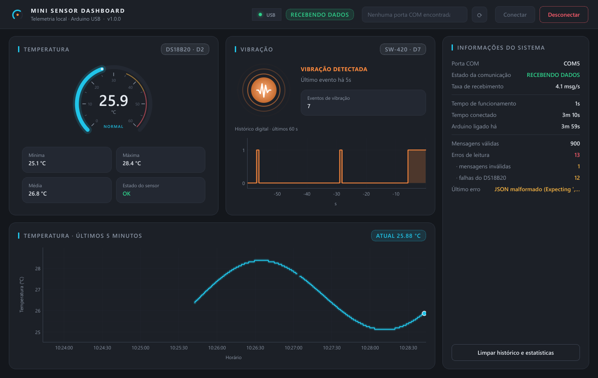

# MINI SENSOR DASHBOARD

Monitoramento de temperatura e vibração **em tempo real** com Arduino Uno ou Leonardo ligado ao PC Windows por USB.
Funciona 100% local: sem Wi-Fi, sem nuvem, sem Firebase.


<sub>Captura gerada com dados de teste injetados no programa para documentação. Com o hardware real, o dashboard mostra somente as leituras recebidas do Arduino.</sub>

## Visão geral

```
 DS18B20 ──D2─┐                   USB Serial 115200 baud            ┌─ Dashboard PyQt6
              ├─ Arduino Uno/Leo ───── JSON por linha ─────► PC ────┤  gauge, gráficos,
 SW-420  ──D7─┘   (firmware)      {"temperature":28.6,...}          └─ estatísticas
```

| Sensor | Função | Pino |
|---|---|---|
| DS18B20 | Temperatura (°C), leitura a cada 1 s | **D2** (S), 5V (V), GND (G) |
| SW-420 | Vibração (0/1), amostragem a cada 20 ms | **D7** (SIG), 5V (VCC), GND (GND), NC livre |

## Início rápido

1. **Instale as dependências:** execute `instalar_dependencias.bat`. Ele instala Python 3.12, os pacotes do dashboard, a Arduino IDE, o core AVR e as bibliotecas, e no fim verifica tudo.
2. **Monte** o circuito: [docs/GUIA_MONTAGEM.md](docs/GUIA_MONTAGEM.md)
3. **Carregue** o firmware `arduino/sensor_monitor/sensor_monitor.ino` pela Arduino IDE.
4. **Execute** o `run.bat`, selecione a porta COM e clique em **Conectar**.

**PC sem internet:** execute `preparar_pacote_offline.bat` num PC com internet, copie a pasta inteira (com `dependencias\`) e rode `instalar_dependencias.bat` no destino. Detalhes no [guia de instalação](docs/GUIA_INSTALACAO.md#pc-sem-internet-pacote-offline).

Passo a passo completo: [docs/GUIA_INSTALACAO.md](docs/GUIA_INSTALACAO.md) · Testes e solução de problemas: [docs/GUIA_TESTES.md](docs/GUIA_TESTES.md)

## Estrutura do projeto

```
mini-dashboard/
├── arduino/
│   └── sensor_monitor/
│       └── sensor_monitor.ino      Firmware (Uno e Leonardo)
├── app/
│   ├── main.py                     Ponto de entrada
│   ├── interface/
│   │   ├── dashboard.py            Janela principal, cards, layout responsivo
│   │   ├── components.py           Gauge, indicador de vibração, LEDs, cards
│   │   └── styles.py               Tema escuro (paleta, fontes, QSS)
│   ├── services/
│   │   ├── serial_service.py       Thread serial, detecção de portas, erros
│   │   └── data_processor.py       Estatísticas, históricos, eventos, taxa
│   ├── models/
│   │   └── sensor_data.py          Modelo e validação do protocolo JSON
│   └── utils/
│       └── configuration.py        Parâmetros centralizados
├── docs/
│   ├── GUIA_MONTAGEM.md            Montagem física, passo a passo
│   ├── GUIA_INSTALACAO.md          Instalação e inicialização (passos 1–11)
│   ├── GUIA_TESTES.md              Testes funcionais e diagnóstico
│   ├── diagrama_protoboard.svg/png Diagrama do circuito
│   ├── variante_ds18b20_sem_modulo.svg/png
│   ├── componentes.svg/png         Identificação visual dos componentes
│   └── captura_dashboard.png
├── tests/
│   └── test_protocolo.py           Testes automáticos (sem hardware)
├── tools/
│   └── diagnostico_serial.py       Monitor serial de linha de comando
├── scripts/
│   ├── config_instalacao.ps1       Versões e URLs fixadas (compartilhado)
│   ├── instalar_dependencias.ps1   Instalador (online ou offline)
│   └── preparar_pacote_offline.ps1 Gera a pasta dependencias\
├── instalar_dependencias.bat       Instala tudo em um PC novo
├── preparar_pacote_offline.bat     Baixa tudo para instalar sem internet
├── requirements.txt                Dependências Python (versões fixas)
├── run.bat                         Inicializador para Windows
└── README.md
```

O firmware fica em `arduino/sensor_monitor/` (e não direto em `arduino/`) porque a Arduino IDE exige que o `.ino` esteja numa pasta com o mesmo nome.

## Funcionalidades

**Firmware**
- Compatível com **Arduino Uno e Leonardo**; aguarda a USB nativa do Leonardo por até 3 s, sem travar.
- **Sem `delay()`**: conversão assíncrona do DS18B20 (pedido a cada 1 s, leitura após ~750 ms) e amostragem do SW-420 a cada 20 ms.
- **Tratamento de falhas**: −127 °C (sensor ausente), 85 °C de reset, valores fora da faixa e perda do sensor, com nova busca automática a cada 5 s. Em caso de falha envia `null`, **nunca um valor inventado**.
- **Polaridade do SW-420 configurável** (`SW420_ACTIVE_LEVEL`).
- Mensagens a cada 200 ms, mais uma imediata quando uma vibração começa. Depuração desligada por padrão; quando ligada, usa linhas iniciadas por `#`, que o dashboard ignora.

**Dashboard**
- Cabeçalho com indicador USB, seleção de porta (★ = provável Arduino), Conectar/Desconectar e estado da conexão.
- **Temperatura**: gauge animado com faixas de alerta, mínima, máxima, média e estado do sensor.
- **Vibração**: indicador com ondas animadas, estado NORMAL / VIBRAÇÃO DETECTADA, contador de eventos e gráfico digital dos últimos 60 s.
- **Gráfico de temperatura** dos últimos 5 minutos com eixo de horário; falhas do sensor aparecem como lacunas.
- **Informações**: porta, taxa de mensagens, tempo de funcionamento, tempo conectado, uptime do Arduino, mensagens válidas, erros de leitura e último erro.
- Comunicação em **thread separada**; detecta desconexão do cabo e porta ocupada; reconexão manual; aviso claro de **SEM DADOS** após 3 s sem mensagens.
- Layout responsivo com 3, 2 ou 1 coluna, conforme a largura da janela.

## Protocolo

```json
{"temperature":28.60,"vibration":1,"timestamp":1200}
```
Uma mensagem por linha (`\n`) a 115200 baud. `temperature` é `null` quando o DS18B20 falha. Especificação completa no [GUIA_TESTES.md](docs/GUIA_TESTES.md#5-referência-do-protocolo).

## Configuração

| Onde | O quê |
|---|---|
| `sensor_monitor.ino` | Polaridade do SW-420, intervalos, tempo de retenção da vibração, modo de depuração |
| `app/utils/configuration.py` | Baud rate, timeout de "sem dados", janelas dos gráficos, faixa e limites de alerta do gauge, tamanhos da janela |

## Requisitos

- Windows 10/11, **Python 3.12+** (exigido pelo NumPy 2.5.5), Arduino IDE 2.x
- Tudo isso é instalado automaticamente pelo `instalar_dependencias.bat`
- Dependências fixas em `requirements.txt`: PyQt6 6.11.0, pyqtgraph 0.14.0, pyserial 3.5, numpy 2.5.5

> **Smart App Control:** o PyQt6 6.12.1 (mais recente na data deste projeto) teve o `QtWidgets.pyd` bloqueado pelo Smart App Control do Windows 11. As versões de `requirements.txt` foram testadas com ele **ativado**.

## Testes

```bat
.venv\Scripts\python.exe -m unittest discover -s tests -v
```
