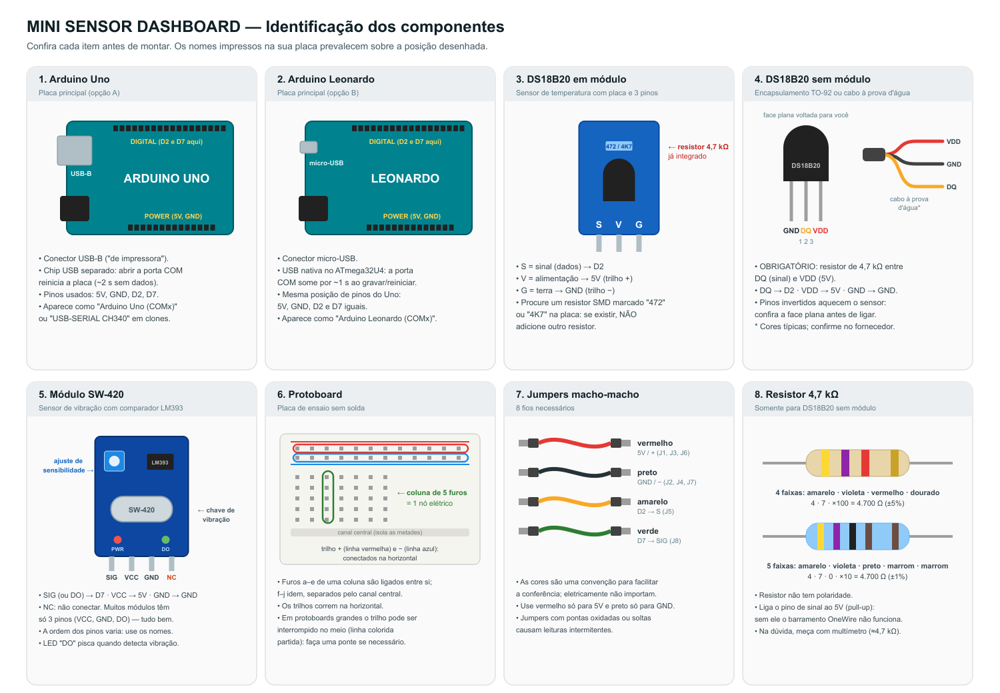
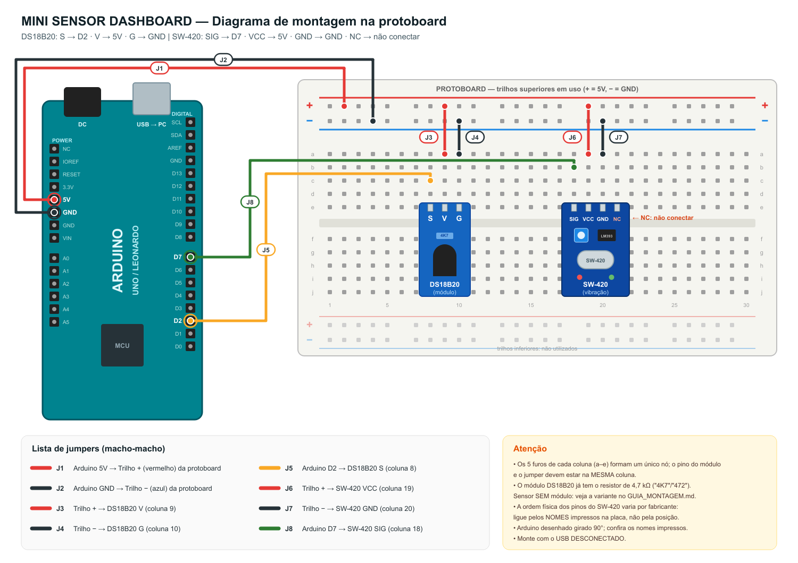
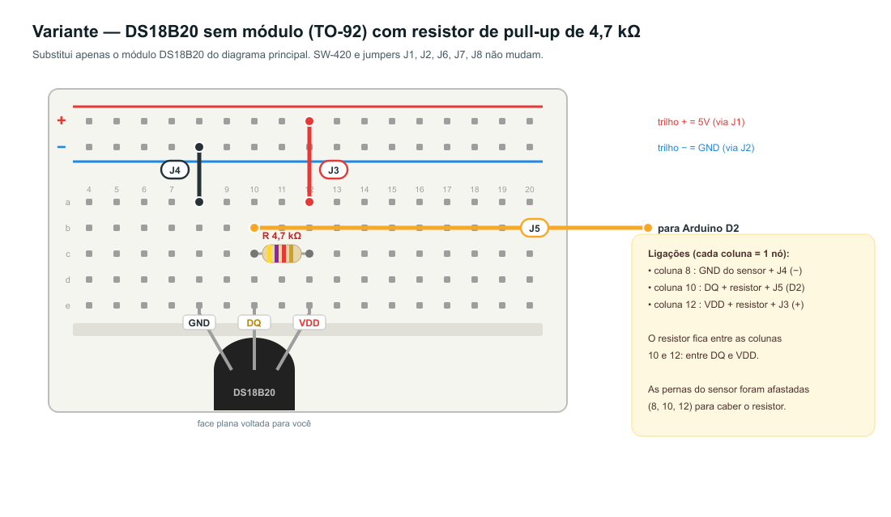

# Guia de montagem física

Este guia mostra como montar o circuito do **Mini Sensor Dashboard** na protoboard.
A pinagem abaixo é **fixa**: o firmware e o dashboard dependem dela.

| Sensor | Pino do sensor | Ligar em |
|---|---|---|
| DS18B20 (temperatura) | **S** (sinal) | **D2** |
| | **V** (VCC) | **5V** (trilho +) |
| | **G** (GND) | **GND** (trilho −) |
| SW-420 (vibração) | **SIG** (às vezes marcado **DO**) | **D7** |
| | **VCC** | **5V** (trilho +) |
| | **GND** | **GND** (trilho −) |
| | **NC** | **não conectar** |

> ⚠️ **Monte tudo com o cabo USB desconectado.** Só ligue o USB depois de conferir as conexões (seção 5).

---

## 1. Identificação dos componentes



| # | Componente | Como reconhecer | Observação |
|---|---|---|---|
| 1 | **Arduino Uno** | Placa azul-esverdeada com conector **USB-B** quadrado | Ao abrir a porta COM a placa reinicia: aguarde ~2 s pelos dados |
| 2 | **Arduino Leonardo** | Mesmo formato do Uno, conector **micro-USB** | USB nativa; a porta COM some por ~1 s ao gravar o firmware |
| 3 | **DS18B20 em módulo** | Pequena placa com o sensor preto (formato TO-92) e 3 pinos **S V G** | Normalmente já tem o resistor de 4,7 kΩ (SMD marcado **472** ou **4K7**) |
| 4 | **DS18B20 sem módulo** | Só o componente preto de 3 pernas, ou o cabo à prova d'água | **Exige** o resistor de 4,7 kΩ (seção 3) |
| 5 | **SW-420** | Placa com um cilindro metálico (a chave de vibração), um trimpot azul e o chip LM393 | Pinos SIG/DO, VCC, GND (e NC em alguns modelos) |
| 6 | **Protoboard** | Placa branca com furos | Colunas de 5 furos interligados e trilhos de alimentação |
| 7 | **Jumpers macho-macho** | Fios com pino nas duas pontas | São necessários 8 |
| 8 | **Resistor de 4,7 kΩ** | Faixas amarelo · violeta · vermelho · dourado (ou amarelo · violeta · preto · marrom · marrom) | **Somente** para DS18B20 sem módulo |

### Compatibilidade com 5 V
- **DS18B20**: opera de 3,0 V a 5,5 V, então 5 V é compatível.
- **SW-420**: os módulos comuns aceitam de 3,3 V a 5 V. Confira a faixa impressa na placa ou no anúncio do seu módulo. Se o seu modelo aceitar **apenas** 3,3 V, não use 5 V.

### Como a protoboard funciona
- Cada **coluna numerada** tem 5 furos (**a–e**) ligados entre si, que formam **um único ponto elétrico**. Os furos **f–j** formam outro ponto, separado pelo canal central.
- Os **trilhos** (linhas vermelha `+` e azul `−` nas bordas) são ligados **na horizontal**, ao longo da placa.
- Em algumas protoboards grandes o trilho é **interrompido no meio**: a linha colorida aparece partida. Se for o caso, use somente um lado ou faça uma ponte com um jumper.

---

## 2. Diagrama do circuito



(Versão vetorial para ampliar ou imprimir: [`diagrama_protoboard.svg`](diagrama_protoboard.svg).)

O Arduino aparece **girado 90°** no desenho para que os pinos fiquem de frente para a protoboard. Na sua placa, guie-se pelos **nomes impressos** ao lado de cada pino.

### Posições usadas na protoboard (exemplo do diagrama)

| Item | Colunas | Fileira do pino |
|---|---|---|
| DS18B20: S, V, G | 8, 9, 10 | e |
| SW-420: SIG, VCC, GND, NC | 18, 19, 20, 21 | e |

Os números de coluna são apenas uma sugestão. O que importa é que **o pino do sensor e o jumper correspondente fiquem na mesma coluna e na mesma metade (a–e)**.

### Lista de jumpers

| Jumper | Cor sugerida | De | Para |
|---|---|---|---|
| J1 | vermelho | Arduino **5V** | trilho **+** |
| J2 | preto | Arduino **GND** | trilho **−** |
| J3 | vermelho | trilho **+** | coluna do **V** do DS18B20 |
| J4 | preto | trilho **−** | coluna do **G** do DS18B20 |
| J5 | amarelo | Arduino **D2** | coluna do **S** do DS18B20 |
| J6 | vermelho | trilho **+** | coluna do **VCC** do SW-420 |
| J7 | preto | trilho **−** | coluna do **GND** do SW-420 |
| J8 | verde | Arduino **D7** | coluna do **SIG** do SW-420 |

O pino **NC** do SW-420 fica sem nenhum fio.

### Esquema elétrico resumido

```
        ARDUINO                      PROTOBOARD
   ┌──────────────┐
   │          5V ─┼──── J1 ───────── trilho + ──┬── J3 ── DS18B20 V
   │              │                             └── J6 ── SW-420 VCC
   │         GND ─┼──── J2 ───────── trilho − ──┬── J4 ── DS18B20 G
   │              │                             └── J7 ── SW-420 GND
   │          D2 ─┼──── J5 ──────────────────────────────── DS18B20 S
   │          D7 ─┼──── J8 ──────────────────────────────── SW-420 SIG
   └──────────────┘                                  SW-420 NC: livre

   Somente DS18B20 SEM módulo:   S/DQ ──[ 4,7 kΩ ]── V/VDD
```

---

## 3. Montagem passo a passo

### Passo 1: alimentação da protoboard
1. Com o USB **desconectado**, encaixe a protoboard ao lado do Arduino.
2. **J1 (vermelho):** ligue o pino **5V** do Arduino (fileira de pinos marcada *POWER*) a qualquer furo do trilho **+** (linha vermelha).
3. **J2 (preto):** ligue um pino **GND** do Arduino (há dois ao lado do 5V; qualquer um serve) a um furo do trilho **−** (linha azul).

> Todos os sensores vão usar este mesmo trilho −, ou seja, o **GND é comum** a todo o circuito. Isso é obrigatório para que os sinais sejam lidos corretamente.

### Passo 2: sensor DS18B20 (módulo)
1. Encaixe os 3 pinos do módulo em **3 colunas diferentes** (ex.: colunas 8, 9 e 10, fileira **e**).
2. **J3 (vermelho):** do trilho **+** até a coluna do pino **V**.
3. **J4 (preto):** do trilho **−** até a coluna do pino **G**.
4. **J5 (amarelo):** do pino **D2** do Arduino até a coluna do pino **S**.
5. **Resistor de pull-up:** procure na placa do módulo um resistor pequeno marcado **472** ou **4K7**. Se ele existir, **não adicione outro**. Se tiver dúvida, com tudo desligado meça a resistência entre **S** e **V** com um multímetro: cerca de 4,7 kΩ indica que o resistor já está presente.

#### Variante: DS18B20 sem módulo (componente solto ou cabo à prova d'água)



Identifique as pernas segurando o sensor com a **face plana voltada para você** e as pernas para baixo. Da esquerda para a direita: **GND · DQ (sinal) · VDD**.

| Perna | Equivale a | Ligar em |
|---|---|---|
| GND (1) | G | trilho − (J4) |
| DQ (2) | S | D2 (J5) |
| VDD (3) | V | trilho + (J3) |

1. Encaixe as pernas em colunas separadas por um furo (ex.: 8, 10, 12) para ter espaço.
2. Coloque o **resistor de 4,7 kΩ** com uma perna na coluna do **DQ** e a outra na coluna do **VDD**. Ele não tem polaridade.
3. No **cabo à prova d'água**, as cores costumam ser: vermelho = VDD, preto = GND, amarelo ou branco = DQ. **Confirme com o fornecedor**, porque alguns cabos usam outras cores.

> ⚠️ Inverter VDD e GND no DS18B20 o deixa **muito quente em segundos** e pode danificá-lo. Se o sensor esquentar, desconecte o USB imediatamente.

### Passo 3: sensor SW-420
1. Encaixe os pinos do módulo em colunas diferentes (ex.: 18 a 21, fileira **e**).
2. **Leia os nomes impressos na placa.** A ordem dos pinos **varia entre fabricantes**, então ligue sempre pelo nome, nunca pela posição do desenho.
3. **J6 (vermelho):** do trilho **+** até a coluna do **VCC**.
4. **J7 (preto):** do trilho **−** até a coluna do **GND**.
5. **J8 (verde):** do pino **D7** do Arduino até a coluna do **SIG** (pode estar marcado **DO** ou **OUT**).
6. **NC:** deixe sem conexão. Muitos módulos têm só 3 pinos (VCC, GND, DO), o que também está correto.

### Passo 4: distribuição da alimentação (resumo)
```
Arduino 5V  ─► trilho + ─►  DS18B20 V   e   SW-420 VCC
Arduino GND ─► trilho − ─►  DS18B20 G   e   SW-420 GND
```
Os dois sensores consomem poucos miliampères. O próprio USB do computador alimenta o circuito, sem fonte externa.

---

## 4. Como evitar conexões incorretas

| Erro comum | Consequência | Como evitar |
|---|---|---|
| Pino do sensor e jumper em **colunas diferentes** | Sem contato elétrico | Confira se estão na mesma coluna numerada |
| Pino e jumper em **metades diferentes** (a–e × f–j) | Sem contato elétrico | O canal central isola as metades |
| Jumper no **trilho errado** (+ × −) | Curto-circuito ou sensor invertido | Vermelho só no +, preto só no − |
| 5V e GND **trocados** no DS18B20 | Sensor aquece e pode queimar | Confira V/VDD e G/GND antes de ligar o USB |
| Sinal em pino diferente de **D2/D7** | Dashboard não recebe leituras | O firmware usa exatamente D2 e D7 |
| Fio no **NC** do SW-420 | Comportamento indefinido | Deixe o NC livre |
| Resistor duplicado no módulo DS18B20 | Pull-up mais forte que o necessário (em geral ainda funciona, mas evite) | Só adicione o resistor no sensor **sem** módulo |
| Usar **3.3V** em vez de **5V** | Leituras instáveis em alguns módulos | Use o pino marcado **5V** |
| Trilho interrompido no meio da protoboard | Metade dos sensores sem alimentação | Use o mesmo lado ou faça uma ponte |

---

## 5. Checklist antes de ligar o USB

- [ ] J1: Arduino **5V** → trilho **+**
- [ ] J2: Arduino **GND** → trilho **−**
- [ ] DS18B20: **V** → +, **G** → −, **S** → **D2**
- [ ] DS18B20 sem módulo: resistor de 4,7 kΩ entre **DQ** e **VDD**
- [ ] SW-420: **VCC** → +, **GND** → −, **SIG/DO** → **D7**, **NC** livre
- [ ] Nenhum jumper liga o trilho + diretamente ao trilho −
- [ ] Todos os pinos estão firmes nos furos

Depois de conferir, conecte o USB. O LED **ON/PWR** do Arduino e o LED **PWR** do SW-420 devem acender. Se algum componente esquentar, desconecte imediatamente e revise as ligações.

Próximo passo: [GUIA_INSTALACAO.md](GUIA_INSTALACAO.md).
